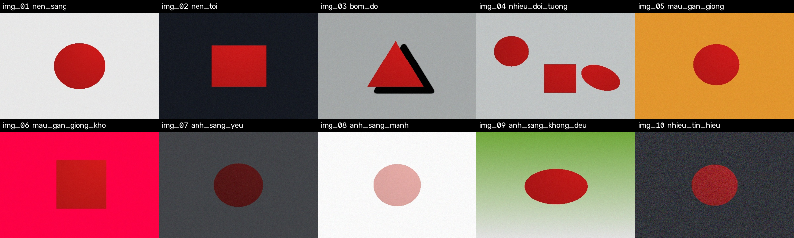
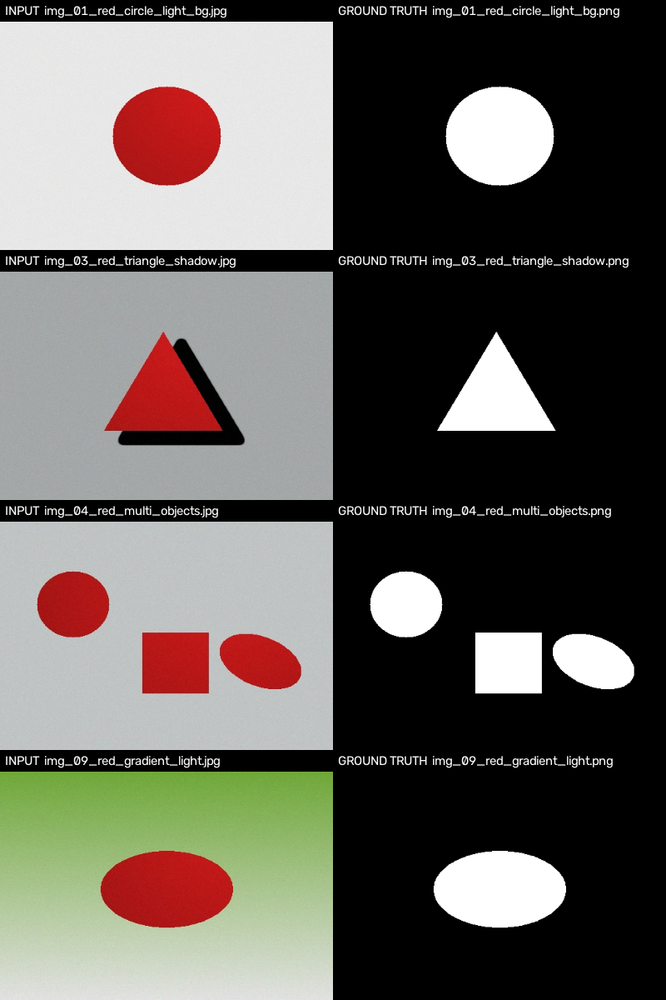
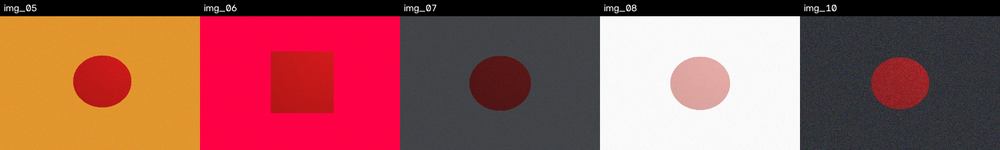
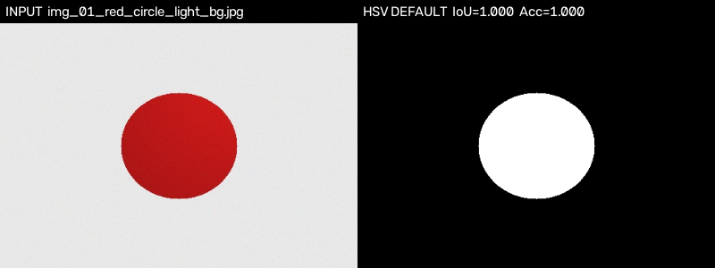
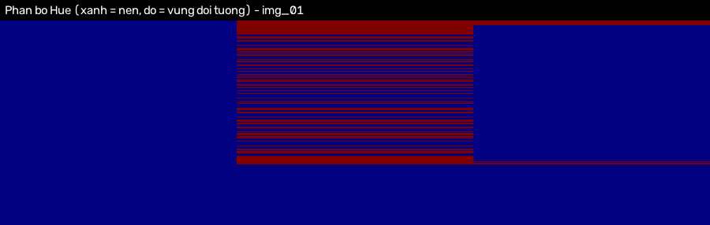

# Báo cáo phần dữ liệu

**Thành viên phụ trách:** Anh Quân (Dữ liệu & Ground Truth)
**Đối tượng trình bày:** cách chọn ảnh, phương pháp tạo Ground Truth, giới hạn của bộ dữ liệu

---

## 1. Màu mục tiêu và tiêu chí chọn ảnh

Nhóm thống nhất chọn **màu đỏ** làm màu mục tiêu, với ngưỡng HSV mặc định:

- Hue: `[0, 10]` ∪ `[170, 180]` (đỏ có hai khoảng Hue — đây chính là điểm khó cần xử lý),
- Saturation `[100, 255]`, Value `[100, 255]`.

Bộ dữ liệu có **10 ảnh**, mỗi ảnh thuộc một tình huống khác nhau. Một ảnh được đưa
vào khi đáp ứng đồng thời: đọc được bằng OpenCV, ảnh màu 3 kênh `uint8`,
có đối tượng đỏ nhận dạng được, Ground Truth cùng kích thước `H×W`, Ground Truth
nhị phân `0/255` và không rỗng, có mô tả trong `metadata.csv`
(chi tiết toàn bộ tiêu chí trong [`data/README.md`](../data/README.md)).

---

## 2. Bảng mô tả bộ ảnh

| Mã | File ảnh | Tình huống | Số vật thể | Tỷ lệ vật thể | HSV trung bình (H / S / V) |
|---|---|---|---|---|---|
| img_01 | `img_01_red_circle_light_bg.jpg` | nen_sang — nền trắng sáng | 1 | 11.1% | 0.0 / 225.2 / 187.1 |
| img_02 | `img_02_red_square_dark_bg.jpg` | nen_toi — nền tối | 1 | 13.5% | 0.0 / 225.8 / 191.6 |
| img_03 | `img_03_red_triangle_shadow.jpg` | bom_do — bóng đổ trên nền | 1 | 7.8% | 0.0 / 225.8 / 187.5 |
| img_04 | `img_04_red_multi_objects.jpg` | nhieu_doi_tuong — 3 vật thể | 3 | 14.6% | 0.0 / 226.1 / 180.7 |
| img_05 | `img_05_red_on_orange_bg.jpg` | mau_gan_giong — nền cam (H≈17) | 1 | 8.9% | 0.0 / 225.8 / 191.7 |
| img_06 | `img_06_red_on_pink_bg.jpg` | mau_gan_giong_kho — nền hồng (H≈172) | 1 | 14.5% | 0.0 / 225.0 / 193.2 |
| img_07 | `img_07_red_low_light.jpg` | anh_sang_yeu — V thấp (~85) | 1 | 9.9% | 0.0 / 198.4 / 85.4 |
| img_08 | `img_08_red_overexposed.jpg` | anh_sang_manh — S thấp (~72) | 1 | 9.4% | 2.2 / 71.5 / 223.3 |
| img_09 | `img_09_red_gradient_light.jpg` | anh_sang_khong_deu — nền chuyển sắc | 1 | 10.5% | 0.0 / 226.1 / 180.4 |
| img_10 | `img_10_red_noisy_dark_bg.jpg` | nhieu_tin_hieu — nhiễu cao | 1 | 8.9% | 179.2 / 207.6 / 151.2 |

> **Lưu ý về cột Hue trung bình:** Hue là đại lượng tuần hoàn trên vòng 0 → 179 → 0.
> Vì vậy Hue trung bình phải được tính theo **trung bình góc** (circular mean), nếu tính
> bằng phép cộng thông thường thì trung bình của 2 và 178 sẽ ra 90 (màu vàng) thay vì
> ~0 (màu đỏ). `scripts/generate_dataset.py` xử lý đúng điều này. Giá trị `179.2` của
> img_10 là do nhiễu làm Hue dao động quanh điểm giao 0/180 — về mặt toán học nó tương
> đương với Hue ≈ 0, tức vẫn là màu đỏ.

Hình tổng quan toàn bộ bộ dữ liệu:


Bản đồ Ground Truth (trắng = đối tượng, đen = nền) của 4 ảnh tiêu biểu:



Các trường hợp khó (từ trái qua phải: nền cam, nền hồng, thiếu sáng, cháy sáng, nhiễu):



---

## 3. Cách tạo Ground Truth

Ground Truth được tạo **đồng thời với việc vẽ ảnh**, theo các bước:

1. Vẽ từng vật thể lên một Mask nhị phân riêng (`cv2.circle`, `cv2.rectangle`,
   `cv2.ellipse`, `cv2.fillPoly` với nét `LINE_8`).
2. Gộp các Mask vật thể bằng `bitwise_or` → Ground Truth cuối cùng.
3. Tô màu vật thể **thông qua chính Mask đó** nên mọi pixel của vật thể mang đúng
   màu đích, Ground Truth khớp tuyệt đối với ảnh đầu vào.
4. Áp dụng hiệu ứng ánh sáng (đổ bóng, bóng đổ, nhiễu) rồi lưu Ảnh (`.jpg`) và
   Mask (`.png`), ghi thêm dòng `metadata.csv`.

Điểm quan trọng (theo Quy ước 3): Ground Truth có **trước** và **độc lập** với mọi
Mask dự đoán từ ngưỡng HSV — nhãn không bao giờ được suy ra từ kết quả của thuật toán
cần đánh giá.

Ví dụ xác minh: chạy cấu hình HSV mặc định trên ảnh `img_01` cho
Accuracy = 1.0000 và IoU = 1.0000, chứng tỏ Ground Truth và ảnh đầu vào hoàn toàn
nhất quán:



### Vì sao Ground Truth khớp được với ảnh khi có đổ bóng?

- **Bóng đổ** (ảnh `img_03`) được vẽ **lên riêng phần nền**, không phủ lên vật thể,
  vì vậy bóng đổ không thuộc Ground Truth — đúng như một người sẽ gán nhãn thủ công.
- **Biến đổi ánh sáng trong vùng vật thể** chỉ làm thay đổi độ sáng (V), không đổi
  Hue, nên không làm sai vùng nhãn: một pixel của con tem đỏ trong bóng râm
  vẫn là con tem đỏ.

---

## 4. Bảng số liệu kiểm tra sức khỏe dữ liệu

Chạy cấu hình HSV mặc định của dự án trên toàn bộ bộ dữ liệu để chứng tỏ
dữ liệu phân biệt được ảnh dễ và ảnh khó (đây là kiểm tra sức khỏe dữ liệu,
không phải kết quả chính thức của Hoàn):

| Mã | Pixel Accuracy | IoU | Precision | Recall | Nhận xét |
|---|---|---|---|---|---|
| img_01 | 1.0000 | 1.0000 | 1.0000 | 1.0000 | Cơ sở: tách hoàn hảo |
| img_02 | 1.0000 | 1.0000 | 1.0000 | 1.0000 | Nền tối không gây nhiễu |
| img_03 | 1.0000 | 0.9999 | 0.9999 | 0.9999 | Bóng đổ bị loại đúng |
| img_04 | 1.0000 | 1.0000 | 1.0000 | 1.0000 | Nhiều vật thể gộp đúng |
| img_05 | 0.9995 | 0.9945 | 0.9945 | 1.0000 | Nền cam: lẫn vài pixel |
| img_06 | 0.1451 | 0.1451 | 0.1451 | 1.0000 | **Khó:** nền hồng (H≈172) rơi vào khoảng đỏ → FP lớn |
| img_07 | 0.9006 | 0.0014 | 1.0000 | 0.0014 | **Khó:** V vật thể (~85) dưới ngưỡng 100 → gần như mất hết |
| img_08 | 0.9060 | 0.0000 | 0.0000 | 0.0000 | **Khó:** S vật thể (~72) dưới ngưỡng 100 → không tách được |
| img_09 | 0.9999 | 0.9991 | 0.9996 | 0.9996 | Ánh sáng không đều vẫn tách được |
| img_10 | 0.9998 | 0.9973 | 0.9988 | 0.9986 | Nhiễu cao nhưng Mask vẫn gần đúng |
| **Trung bình** | **0.8951** | **0.7137** | — | — | 7/10 ảnh dễ, 3/10 ảnh khó phân biệt |

Phân bố Hue trên ảnh `img_01` (đỏ = vùng đối tượng, tập trung ở H = 0 và H = 179):



Ý nghĩa của bảng trên đối với cả nhóm:

- 7 ảnh dễ là **nền tảng tích hợp**: pipeline phải đạt IoU ≈ 1.0 trên các ảnh này,
  nếu không thì lỗi nằm ở code chứ không phải ở dữ liệu.
- 3 ảnh khó là **thước đo cải tiến**: Mạnh Quân, Anh Tuấn, Quốc Anh có cơ sở để
  chứng minh ngưỡng vượt trội, Median Filter và Morphology mang lại giá trị gì.

---

## 5. Danh mục tình huống và vai trò trong đánh giá

| Tình huống | Mã ảnh | Vai trò |
|---|---|---|
| Nền sáng / nền tối | img_01, img_02 | Kiểm tra ngưỡng Value có phân biệt được nền và vật thể không |
| Bóng đổ | img_03 | Kiểm tra bóng trên nền không bị tính thành đối tượng |
| Nhiều đối tượng | img_04 | Kiểm tra vùng đối tượng rời rạc được gộp đúng |
| Màu gần giống (dễ) | img_05 | Kiểm tra ngưỡng Hue hẹp loại được nền cam |
| Màu gần giống (**khó**) | img_06 | Bẫy ngưỡng: Hue nền nằm trong khoảng đỏ → dự kiến FP lớn |
| Ánh sáng yếu (**khó**) | img_07 | Bẫy ngưỡng: V vật thể dưới ngưỡng → dự kiến FN lớn |
| Ánh sáng quá mạnh (**khó**) | img_08 | Bẫy ngưỡng: S vật thể dưới ngưỡng → dự kiến không tách được |
| Ánh sáng không đều | img_09 | Kiểm tra một ngưỡng cố định xử lý được ảnh nhiều vùng sáng |
| Nhiễu cao | img_10 | Kiểm tra vai trò của Median Filter trên Mask thô |

---

## 6. Cách bảo đảm nhãn khớp ảnh

1. **Cùng hình học:** Ground Truth được vẽ từ cùng một lệnh vẽ với vật thể trong ảnh,
   không qua bước trung gian — sai số căn chỉnh bằng 0.
2. **Cùng kích thước:** mọi ảnh và Mask đều `480 × 360`, được kiểm tra bằng
   `loader.validate_pair()` trong `src/data_loader.py`.
3. **Nhị phân chuẩn:** mọi Mask chỉ chứa giá trị `0` và `255`, kiểu `uint8`, 1 kênh.
4. **Kiểm thử tự động:** `tests/test_data.py` (nhóm `TestRealDataset`) kiểm tra toàn bộ
   10 cặp ảnh/GT, metadata và đa dạng tình huống — 26/26 test đạt.
5. **Rà soát thủ công:** toàn bộ 10 cặp ảnh/GT đã được mở và xem lại bằng mắt
   (hình `input_vs_gt.png` ở trên là một phần của quá trình rà soát).

Chạy kiểm tra bất cứ lúc nào:

```bash
python -m src.data_loader     # báo cáo kiểm tra dữ liệu
python -m pytest tests/test_data.py -v
```

---

## 7. Bàn giao cho nhóm

| Hạng mục | Bàn giao cho | Trạng thái |
|---|---|---|
| Bộ ảnh đầu vào + Ground Truth | Mạnh Quân (chạy 3 bộ ngưỡng), Anh Tuấn (thử kernel), Quốc Anh (thử morphology) | ✅ `data/images/`, `data/ground_truth/` |
| Bộ đọc dữ liệu + API | Hoàn (tích hợp pipeline) | ✅ `src/data_loader.py` |
| Metadata tình huống | Cả nhóm (phân tích FP/FN theo ảnh) | ✅ `data/metadata.csv` |
| Báo cáo phần dữ liệu | Cả nhóm (báo cáo + slide) | ✅ `report/data.md` + `report/figures/` |

### Kiểm chứng bàn giao

```bash
python -m pytest tests/test_data.py -v   # 26/26 test đạt
python -m src.data_loader                 # 10/10 cặp hợp lệ
```

Kết quả chạy pipeline end-to-end (HSV mặc định → Median 5×5 → Closing 5×5) trên
toàn bộ bộ dữ liệu được lưu tại `report/data_handover_results.csv`:
**10/10 ảnh chạy thành công, không lỗi**, Pixel Accuracy trung bình 0.8951 và
IoU trung bình 0.7135 (3 ảnh khó chiếm phần lớn độ số hụt, xem mục 4).

Giao diện web cũng đã kiểm tra với ảnh trong bộ dữ liệu mới: `/api/upload` và
`/api/process` trả về 200, số pixel Mask thô 13416 — khớp đúng số pixel đối tượng
trong Ground Truth của `img_03`.

---

## 8. Giới hạn của bộ dữ liệu

1. **Ảnh tổng hợp, không phải ảnh chụp.** Để có Ground Truth chính xác 100% và tái lập
   được, nhóm dùng script `scripts/generate_dataset.py` (seed 42) thay vì chụp thủ công.
   Hạn chế: ảnh tổng hợp ít phức tạp hơn ảnh thật (không có chi tiết nền tự nhiên,
   không có biến dạng ống kính, không có nén ảnh phức tạp).
2. **Quy mô nhỏ:** 10 ảnh, một màu mục tiêu duy nhất (đỏ). Kết luận về ngưỡng tối ưu
   chỉ có giá trị trong phạm vi bộ dữ liệu này.
3. **Vật thể hình học đơn giản:** tròn, vuông, tam giác, elip. Không có vật thể tự nhiên
   (hoa, quả, biển báo) với đường biên phức tạp và vùng chuyển màu.
4. **Chưa có ảnh chụp thật để đối chứng.** Bước tiếp theo: bổ sung 3–5 ảnh chụp thật
   kèm Mask gán nhãn thủ công, chạy lại `full_check()` để xác nhận pipeline hoạt động
   ngoài bộ tổng hợp.

---

*Phụ lục kỹ thuật (schema metadata, quy ước đặt tên, cách tái tạo dữ liệu):
xem [`data/README.md`](../data/README.md).*