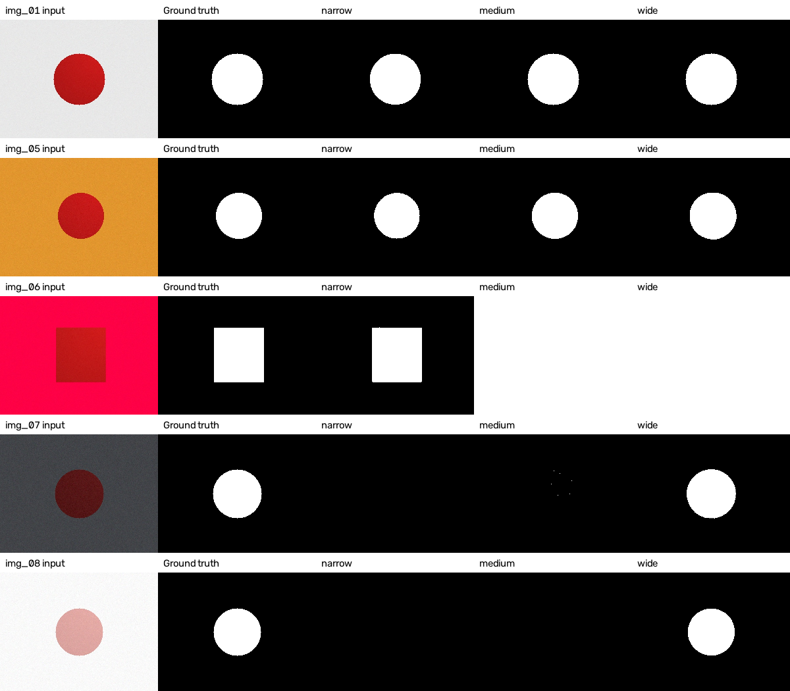

# Báo cáo phần HSV: tách đối tượng màu đỏ

## 1. Phạm vi và quy ước

Phần HSV thực hiện chuyển BGR sang HSV, chọn ngưỡng, tạo mask thô, xử lý hai đầu Hue của màu đỏ và so sánh ngưỡng. Lý thuyết kèm hình nằm trong [hsv_theory.md](hsv_theory.md). Không áp dụng lọc trung vị hoặc hình thái học trong thực nghiệm này: các ảnh mask đều là đầu ra trực tiếp của `HSVSegmenter.segment`.

Ảnh đầu vào là mảng NumPy `uint8` có shape `(H, W, 3)` theo thứ tự BGR. Ảnh HSV giữ nguyên shape và dtype. Với `cv2.COLOR_BGR2HSV` cho ảnh 8-bit, H nằm trong 0–179, S và V trong 0–255. Module chấp nhận 180 làm cận trên Hue để tương thích cấu hình chung; giá trị ảnh H vẫn tối đa 179.

Mask là mảng `(H, W)` một kênh `uint8`: trắng 255 nghĩa là pixel được ngưỡng chọn; đen 0 nghĩa là bị loại. Trắng không đảm bảo pixel thực sự thuộc đối tượng: phải đối chiếu nhãn tham chiếu.

## 2. Nguyên lý và ngưỡng

`bgr_to_hsv` kiểm tra ảnh không rỗng, ba kênh, dtype uint8 và gọi `cv2.cvtColor`. `create_mask` kiểm tra shape/dtype HSV rồi tạo điều kiện từng kênh bằng `cv2.inRange`. Các cận đều bao hàm: min ≤ giá trị ≤ max. Các khoảng Hue được OR với nhau; kết quả được AND với điều kiện S và V. Cách này tương đương kết hợp các hộp lower/upper HSV có cùng khoảng S/V.

Màu đỏ nằm ở hai đầu vòng Hue nên cả ba cấu hình đều dùng hai khoảng. `update_config` cho phép thay ngưỡng và kiểm tra min ≤ max, giá trị nguyên, phạm vi hợp lệ; nếu cập nhật sai thì giữ cấu hình cũ.

Ba cấu hình được định nghĩa tại `scripts/run_hsv_comparison.py` và lưu nguyên giá trị trong [hsv_results.json](hsv_results.json):

- **Hẹp / narrow:** H = [0,5] ∪ [175,179], S = [150,255], V = [150,255]. Loại nhiều vùng nhạt/tối, dễ bỏ sót đối tượng.
- **Vừa / medium:** H = [0,10] ∪ [170,179], S = [100,255], V = [100,255]. Tương đương phạm vi thực tế của cấu hình mặc định [170,180] trong module.
- **Rộng / wide:** H = [0,15] ∪ [165,179], S = [50,255], V = [50,255]. Nhận thêm sắc đỏ lệch, nhạt hoặc tối, nhưng có nguy cơ nhận nhầm nền gần đỏ.

Ví dụ lower/upper của ngưỡng vừa là `(0,100,100)` đến `(10,255,255)` và `(170,100,100)` đến `(179,255,255)`. Mask hai khoảng được OR.

## 3. Dữ liệu và cách chạy

Sử dụng nguyên trạng 10 cặp ảnh JPG và nhãn PNG đã nhận từ nhánh AQuan trong `data/images/` và `data/ground_truth/`. Đây là **bộ ảnh tổng hợp được sinh bằng script** `scripts/generate_dataset.py`, không phải ảnh chụp thực tế. Nhãn có sẵn độc lập với ngưỡng đang thử; không sinh nhãn từ mask dự đoán.

Mỗi ảnh được giữ nguyên trong cả ba cấu hình: không thay kích thước, không lọc, không thay ánh sáng. Tổng cộng 30 lượt phân đoạn. Script dùng lại `SegmentationEvaluator` sẵn có để đối chiếu nhãn, không sửa module đánh giá. Mã SHA-256 của ảnh/nhãn và phiên bản OpenCV/NumPy được ghi trong kết quả để xác định đầu vào.

Chạy từ thư mục dự án:

```bash
python scripts/run_hsv_comparison.py
python -m unittest discover -s tests -v
```

Script tự xác định đường dẫn dự án nên cũng có thể gọi bằng đường dẫn tuyệt đối từ thư mục khác. Đầu ra gồm mask từng ảnh/ngưỡng, ảnh ghép, cấu hình, CSV và JSON trong `results/hsv_dataset_comparison/`. Vì dự án bỏ qua `results/` khi dùng Git, hình báo cáo được lưu riêng trong `report/figures/hsv_*.png`, và toàn bộ tham số/số liệu được giữ trong `report/hsv_results.json`. Có thể tái tạo mask bằng lệnh trên.

## 4. Hình mask thô



Mỗi hàng lần lượt là ảnh đầu vào, nhãn tham chiếu, mask hẹp, vừa, rộng. Năm hàng lần lượt là img_01 (nền sáng), img_05 (nền cam), img_06 (nền hồng), img_07 (ánh sáng yếu), img_08 (quá sáng). Ảnh được thu nhỏ chỉ để trình bày; số liệu tính ở kích thước gốc.

## 5. Kết quả đo

Pixel Accuracy = (TP + TN) / tổng pixel; IoU = TP / (TP + FP + FN). TP là pixel đối tượng được chọn đúng, TN là pixel nền bị loại đúng, FP là nền bị nhận nhầm và FN là đối tượng bị bỏ sót.

Giá trị sau là trung bình số học của chỉ số từng ảnh trên 10 ảnh, không phải tỷ lệ pixel được mask chọn:

- Ngưỡng **hẹp:** Pixel Accuracy **97,52%**, IoU **74,22%**, Precision 80,00%, Recall 74,22%, F1 76,40%.
- Ngưỡng **vừa:** Pixel Accuracy **89,51%**, IoU **71,37%**, Precision 81,38%, Recall 79,99%, F1 72,52%.
- Ngưỡng **rộng:** Pixel Accuracy **91,21%**, IoU **89,17%**, Precision 89,30%, Recall 99,87%, F1 91,37%.

### Nhận xét từng tình huống

Ở img_01, ngưỡng vừa đạt IoU 100%; ngưỡng hẹp bỏ sót 249 pixel, ngưỡng rộng nhận nhầm 21 pixel. Mở rộng ngưỡng không tự động tăng chất lượng khi điều kiện ảnh vốn phù hợp với ngưỡng vừa.

Ở img_06 nền hồng, ngưỡng hẹp đạt IoU 99,94%. Ngưỡng vừa và rộng chọn toàn ảnh, nhận nhầm 147.734 pixel nền, IoU chỉ 14,51%. Màu nền nằm trong phạm vi HSV được chọn nên cách đặt ngưỡng theo màu gặp giới hạn rõ ràng.

Ở img_07 ánh sáng yếu, ngưỡng hẹp không chọn pixel nào; ngưỡng vừa chỉ nhận 24 pixel đối tượng, IoU 0,14%; ngưỡng rộng đạt IoU 98,13%. Việc giảm V tối thiểu giúp giữ vùng đỏ tối.

Ở img_08 quá sáng, hẹp và vừa bỏ sót toàn bộ đối tượng, trong khi rộng đạt IoU 98,68%. Giảm giới hạn S giúp nhận các vùng màu bị nhạt.

Trong ba cấu hình này, rộng có IoU trung bình cao nhất nhưng vẫn thất bại ở nền hồng. Hẹp có Pixel Accuracy cao hơn vì loại đúng phần lớn nền, dù bỏ sót hoàn toàn đối tượng trong hai ảnh. Vì vậy cần xem IoU cùng Pixel Accuracy, và không kết luận một ngưỡng tốt cho mọi ảnh. Thử nghiệm thay cả H/S/V cùng lúc nên cho biết ảnh hưởng của cấu hình tổng thể, không tách riêng đóng góp từng kênh. Các ngưỡng được so sánh trên cùng bộ dữ liệu, chưa có bộ kiểm tra độc lập; kết quả chỉ áp dụng cho bộ ảnh tổng hợp này.

### Đính chính thí nghiệm tổng hợp cũ

Bộ ô màu cũ ở `results/hsv_threshold_comparison/` chỉ phục vụ minh họa. Với V tối thiểu 100, đỏ tối V = 128 vẫn được chọn. Khi S tối thiểu bằng 0, nền xám cũng có thể được nhận do H được OpenCV biểu diễn bằng 0. Vì vậy 57.600 pixel của ngưỡng rộng cũ bao gồm cả nền, không chỉ vùng đỏ. Các cấu hình cũ khác cấu hình của lần chạy mới; không dùng số cũ để đối chiếu hình và số liệu trong báo cáo này.

## 6. Kiểm thử và hoàn tất

`tests/test_hsv.py` hiện có 11 test: chuyển đổi đúng shape/dtype; từ chối sai shape/dtype; mask nhị phân và nhận đúng các vùng trên ảnh nhiều màu; nhận H = 0 và H = 179; ba ngưỡng trên cùng ảnh; cập nhật sai không đổi cấu hình; từ chối Hue ngoài miền; ảnh đơn sắc đỏ/xanh/xám/đen; đỏ trên nền cam/hồng; cận ngưỡng bao hàm; thống kê HSV.

Kết quả chạy `python -m unittest discover -s tests -v`: **45 test đạt**, gồm **11 test HSV**. Tám mục được giao đã có sản phẩm: lý thuyết và hình; chuyển đổi; cấu hình ngưỡng; mask thô; hai khoảng Hue; ba cấu hình chạy trên dữ liệu có nhãn; kiểm thử; báo cáo có hình và tham số khớp lần chạy. Chưa thực hiện lọc trung vị, hình thái học hoặc sửa phần việc của thành viên khác trong công việc này.
