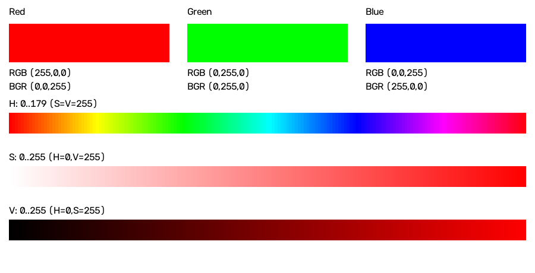

# Lý thuyết BGR/RGB và HSV

## 1. BGR và RGB

Ảnh màu số thường biểu diễn mỗi pixel bằng ba thành phần màu đỏ (Red), xanh lá (Green) và xanh dương (Blue). Hai cách lưu phổ biến là:

- **RGB:** thứ tự kênh là Đỏ, Xanh lá, Xanh dương.
- **BGR:** thứ tự kênh là Xanh dương, Xanh lá, Đỏ.

BGR và RGB chứa cùng ba thành phần, nhưng thứ tự khác nhau. OpenCV đọc ảnh màu bằng `cv2.imread` theo thứ tự BGR. Vì vậy, khi dùng một ảnh OpenCV với thư viện hoặc hàm đang mong đợi RGB, cần đổi thứ tự kênh; nếu không, màu hiển thị hoặc xử lý có thể bị sai. Hàm `cv2.cvtColor(image_bgr, cv2.COLOR_BGR2HSV)` sử dụng đúng quy ước đầu vào BGR để chuyển sang HSV.

Minh họa giá trị pixel (mỗi kênh 8-bit):

| Màu hiển thị | RGB | BGR |
|---|---:|---:|
| Đỏ | `(255, 0, 0)` | `(0, 0, 255)` |
| Xanh lá | `(0, 255, 0)` | `(0, 255, 0)` |
| Xanh dương | `(0, 0, 255)` | `(255, 0, 0)` |

Trong RGB/BGR 8-bit, mỗi kênh có giá trị từ 0 đến 255. Ví dụ đỏ thuần có thành phần đỏ tối đa, còn hai thành phần xanh lá và xanh dương bằng 0.

## 2. Không gian màu HSV

HSV biểu diễn màu theo ba thành phần gần với cách con người mô tả màu hơn:

- **H (Hue - sắc độ):** loại màu, ví dụ đỏ, vàng, xanh lá hoặc xanh dương.
- **S (Saturation - độ bão hòa):** mức độ đậm/rực của màu. S thấp thường gần xám; S cao thể hiện màu rõ hơn.
- **V (Value - độ sáng):** độ sáng của pixel. V thấp gần đen; V cao sáng hơn.

Có thể hình dung HSV như một hình trụ: H là góc quanh trục để chỉ sắc màu, S là khoảng cách từ tâm để chỉ độ bão hòa, và V là chiều cao biểu diễn độ sáng. Đây là mô hình khái niệm, không phải ảnh minh họa dữ liệu đo.

### Thang HSV 8-bit trong OpenCV

Với ảnh 8-bit thông thường, OpenCV dùng các thang sau:

| Kênh | Khoảng giá trị | Ý nghĩa |
|---|---:|---|
| H | `0–179` | Sắc độ; tương ứng xấp xỉ 0–360 độ, mỗi đơn vị H tương ứng khoảng 2 độ |
| S | `0–255` | Độ bão hòa, thấp đến cao |
| V | `0–255` | Độ sáng, tối đến sáng |

**Lưu ý:** tài liệu OpenCV mô tả H là `0–180`, nhưng giá trị H thực tế trong ảnh `uint8` là `0–179` vì đây là 180 mức nguyên. Khi dùng `cv2.inRange`, giới hạn 180 có thể được ghi trong ngưỡng mà không gây lỗi, nhưng không có pixel 8-bit nào mang giá trị H bằng 180. Không nhầm thang này với HSV dấu phẩy động, trong đó H thường nằm trong `[0, 360)` và S/V trong `[0, 1]`.

## 3. Vì sao dùng HSV để phân đoạn màu

Trong RGB/BGR, thay đổi ánh sáng có thể làm thay đổi đồng thời nhiều kênh. HSV tách sắc độ khỏi độ bão hòa và độ sáng, nên có thể chọn vùng màu mục tiêu bằng ngưỡng H rõ ràng hơn, đồng thời giới hạn S và V để loại màu nhạt hoặc quá tối.

Quy trình khái quát:

1. Đọc ảnh bằng OpenCV dưới dạng BGR.
2. Chuyển ảnh sang HSV.
3. Chọn khoảng H, S, V phù hợp với đối tượng.
4. Đánh dấu pixel nằm trong khoảng đã chọn là đối tượng, các pixel còn lại là nền.

Ngưỡng phù hợp phụ thuộc vào ảnh, thiết bị, ánh sáng, cân bằng trắng, bóng đổ và bề mặt vật thể. Vì vậy, cần thử trên ảnh mẫu thay vì xem một bộ ngưỡng là đúng cho mọi điều kiện.

## 4. Ví dụ màu mục tiêu: đỏ

Sắc đỏ nằm gần điểm nối giữa cuối và đầu vòng Hue. Do đó, thường cần kết hợp hai khoảng H. Cấu hình mặc định trong module phân đoạn của dự án là:

```python
config = {
    "color_name": "Red",
    "hue_ranges": [[0, 10], [170, 180]],
    "saturation": [100, 255],
    "value": [100, 255],
}
```

Theo thang 8-bit của OpenCV, hai khoảng Hue này chọn gần `0–10` và `170–179`. Giới hạn S/V từ 100 trở lên giúp bỏ bớt pixel ít bão hòa hoặc quá tối; đây chỉ là điểm bắt đầu để thử nghiệm. Có thể điều chỉnh từng giới hạn khi quan sát mặt nạ trên ảnh thực tế.

## 5. Hình minh họa BGR/RGB và H/S/V



Hàng trên là ba ô đỏ, xanh lá, xanh dương với giá trị RGB và BGR tương ứng. Cùng một màu có thứ tự số khác nhau khi đổi RGB sang BGR.

Ba dải phía dưới được tạo bằng `cv2.COLOR_HSV2BGR` để hiển thị đúng màu:

- Dải H thay đổi từ 0 đến 179, giữ S = V = 255: thể hiện một vòng sắc độ, với đỏ ở hai đầu.
- Dải S thay đổi từ 0 đến 255, giữ H = 0, V = 255: từ trắng sang đỏ bão hòa.
- Dải V thay đổi từ 0 đến 255, giữ H = 0, S = 255: từ đen sang đỏ sáng.

Hình được sinh bởi `scripts/run_hsv_comparison.py`. Đây là minh họa lý thuyết có tham số xác định; ảnh HSV không được hiển thị trực tiếp như RGB.

Khi S = 0, pixel là màu vô sắc và H không có ý nghĩa nhận diện màu. Khi V = 0, pixel là đen. Vì vậy ngưỡng màu cần giới hạn cả S và V, tránh chỉ dựa trên H.

## Tài liệu tham khảo

- OpenCV, *Color conversions*: https://docs.opencv.org/4.x/d8/d01/group__imgproc__color__conversions.html
- OpenCV, *Basic Operations on Images* (đọc và xử lý ảnh): https://docs.opencv.org/4.x/d3/df2/tutorial_py_basic_ops.html
- OpenCV, *Thresholding Operations Using inRange*: https://docs.opencv.org/4.x/da/d97/tutorial_threshold_inRange.html
