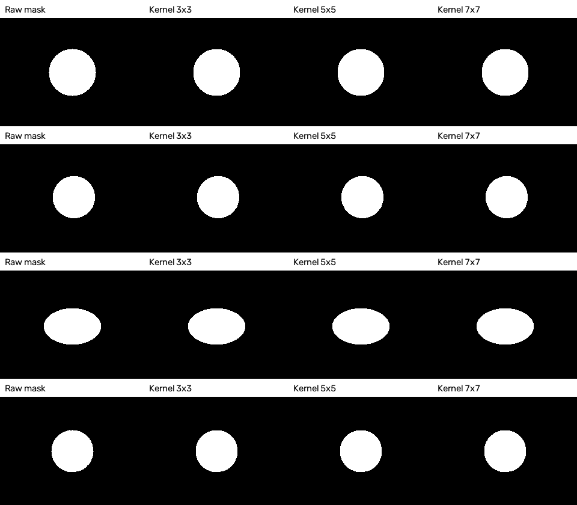
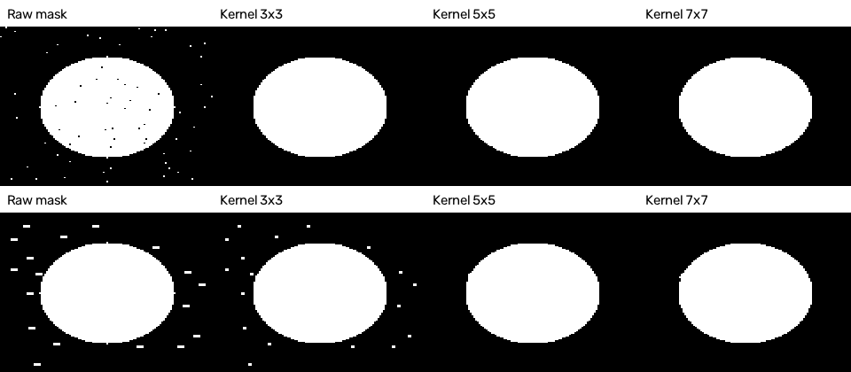

# Báo cáo phần Median Filter: lọc trung vị khử nhiễu mask

**Thành viên phụ trách:** Anh Tuấn
**Module:** [`src/median_filter.py`](../src/median_filter.py)
**Lý thuyết chi tiết:** [median_theory.md](median_theory.md)
**Hướng dẫn tích hợp:** [README_module.md](../README_module.md)

---

## 1. Phạm vi và quy ước

Báo cáo này trình bày bước **lọc trung vị (Median Filter)** trong pipeline
`Loader → HSV → Median Filter → Morphology → Evaluation`. Phần lý thuyết
chi tiết (nguyên lý cửa sổ trượt, tính phi tuyến, ví dụ tính tay 3 × 3) nằm
ở [median_theory.md](median_theory.md).

Quy ước mask áp dụng trong toàn bộ công việc này (giống
[module_contracts.md](../module_contracts.md)):

* Mảng NumPy 2 chiều `(H, W)`, một kênh, `dtype = uint8`.
* Chỉ chứa hai giá trị: `0` (nền) và `255` (đối tượng).
* Hàm lọc không thay đổi mảng đầu vào và không đổi kích thước ảnh.

Mọi số liệu trong báo cáo được đo bằng `SegmentationEvaluator` sẵn có của nhóm
(`src/evaluation.py`) trên mask đầu ra của bước HSV, **không** áp dụng thêm
phép hình thái học nào. Như vậy thay đổi trong số liệu là do Median Filter
gây ra, không do bước khác chen vào.

### 1.1. Cơ sở lý thuyết và vì sao áp dụng ngay sau bước HSV

`HSVSegmenter.create_mask()` xác định pixel đối tượng bằng cách chọn ngưỡng
độc lập trên từng kênh H, S, V rồi AND các điều kiện lại. Một pixel bị loại
hoặc bị chọn sai chỉ cần lệch ngưỡng một chút là đổi trạng thái, nên trên ảnh
có nhiễu cảm biến hoặc ánh sáng yếu, mask thô thường xuất hiện:

* **Nhiễu muối tiêu**: các pixel lẻ trắng trên nền và các lỗ đen lẻ bên trong
  vùng đối tượng (ảnh `img_10_red_noisy_dark_bg` thuộc nhóm này).
* **Lỗ hổng cạnh biên**: vài pixel viền bị đảo trạng thái khi ngưỡng nằm sát
  giá trị của pixel.

Lọc trung vị là lựa chọn phù hợp ở bước này vì ba tính chất sau:

1. **Phi tuyến, bảo toàn biên**: giá trị trung vị chỉ phụ thuộc vào *thứ tự*
   các pixel trong cửa sổ chứ không phụ thuộc vào tổng của chúng, nên một
   điểm nhiễu đơn lẻ không thể kéo biên đối tượng.
2. **Triệt tiêu nhiễu xung**: với cửa sổ 3 × 3, trung vị chỉ bị ảnh hưởng khi
   có **từ 5 pixel nhiễu trở lên** trong cửa sổ, nên nhiễu muối tiêu đơn lẻ
   bị loại bỏ triệt để.
3. **Giữ nguyên tính nhị phân**: trung vị của tập chỉ gồm `{0, 255}` luôn là
   `0` hoặc `255`, nên không sinh ra mức xám trung gian - điều mà lọc trung
   bình (Mean) và lọc Gaussian chắc chắn sẽ gây ra, và làm hỏng quy ước mask
   của nhóm.

Vì sao **trước** bước hình thái học: nếu chạy Closing trước, các lỗ nhiễu
nhỏ sẽ được "vá" lại thành vùng liền khối và Median Filter sau đó không còn
tách được chúng ra; ngược lại, Median Filter loại nhiễu trước thì Closing chỉ
còn xử lý lỗ hình thái thật sự (lỗ lớn, khoét rỗng).

## 2. Thiết kế thuật toán và quy ước kiểm soát đầu vào

### 2.1. Giao diện hàm

```python
apply_median_filter(mask_raw: np.ndarray, kernel_size: int = 3) -> np.ndarray
```

Hàm thực hiện đúng ba việc:

1. Kiểm tra đầu vào theo quy ước mask của nhóm (xem mục 2.2).
2. Gọi `cv2.medianBlur(mask_raw, kernel_size)` trên bản sao liên tục của mảng
   (`np.ascontiguousarray`), nên mảng gốc không bị mutate.
3. Chuẩn hóa đầu ra về `uint8` và ép mọi giá trị khác 0 thành 255, bảo đảm
   đầu ra vẫn là mask nhị phân đúng quy ước.

Ngoài hàm chính, module còn cung cấp:

| Hàm | Công dụng |
|---|---|
| `median_filter(mask_raw, kernel_size=3)` | Alias ngắn của hàm chính. |
| `compare_kernels(mask_raw, kernel_sizes=(3, 5, 7), ground_truth=None)` | Chạy nhiều kernel và trả về số liệu so sánh (số pixel đổi, pixel thêm/bớt, IoU nếu có nhãn). |
| `MedianFilter(kernel_size=5)` | Lớp giữ nguyên API cũ (`filter`, `filter_with_comparison`, `set_kernel_size`, `get_kernel_size`) để `main.py` và `experiment.py` không phải sửa. |

### 2.2. Kiểm soát đầu vào

| Kiểm tra | Hành động |
|---|---|
| `mask_raw` là `None` | `ValueError` |
| `mask_raw` không phải `np.ndarray` | `TypeError` |
| `mask_raw.size == 0` | `ValueError` |
| `mask_raw.ndim != 2` (ảnh RGB/BGR, hoặc `(H, W, 1)`) | `ValueError` kèm nhắc phải quy về mask 1 kênh |
| `mask_raw.dtype != np.uint8` | `TypeError` |
| Giá trị pixel ngoài `{0, 255}` (ví dụ `128`) | `ValueError` |
| Mask theo quy ước `0/1` | `ValueError` kèm hướng dẫn nhân 255 |
| `kernel_size` là `bool` | `TypeError` |
| `kernel_size` không phải số nguyên (`3.0`, `'3'`, `None`) | `TypeError` |
| `kernel_size < 3` | `ValueError` |
| `kernel_size` chẵn | `ValueError` |
| `kernel_size > 31` (quy ước nhóm, kernel quá lớn không hiệu quả) | `ValueError` |

Mọi thông báo lỗi đều nêu rõ quy ước (`0/255`, `uint8`, 2 chiều, kernel lẻ
`>= 3`) để người khác sửa được ngay. Chi tiết từng thông báo nằm ở
[README_module.md](../README_module.md).

### 2.3. Bộ dữ liệu kiểm thử

Ba fixture tổng hợp được sinh tất định bằng
`python tests/fixtures/median/generate_fixtures.py` (seed cố định, mỗi fixture
một seed riêng):

| Fixture | Vai trò |
|---|---|
| `noisy_salt_pepper_3x3.png` + `expected_clean_3x3.png` | 40 điểm muối + 25 điểm tiêu trên hình tròn; kernel 3 × 3 phải khớp **100 %** với ảnh sạch. |
| `dense_noise_clusters.png` + `expected_clean_dense.png` | 18 cụm nhiễu 2 × 4; kernel 3 × 3 còn sót nhiễu, kernel 5 × 5 loại sạch. |
| `fine_details_edges.png` | Đường 1–2 pixel, chữ thập mảnh, góc nhọn để đo tác dụng phụ của kernel lớn. |

Chi tiết từng file: [`tests/fixtures/median/README.md`](../tests/fixtures/median/README.md).

### 2.4. Khi nào dùng Median, Bilateral hay Morphology?

Ba bộ lọc này hay bị nhầm lẫn vì cùng đặt ở bước làm sạch mask, nhưng chúng
giải quyết hai loại vấn đề khác nhau:

| | **Median Filter** | **Bilateral Filter** | **Morphology (Open/Close)** |
|---|---|---|---|
| Bản chất | Thống kê thứ tự trong cửa sổ | Trọng số theo cả giá trị và không gian | Phép toán hình thái trên cấu trúc vùng |
| Xử lý nhiễu xung (muối tiêu) | **Tốt nhất** | Trung bình | Không xử lý nhiễu xung |
| Xử lý nhiễu nhẹ trong vùng đồng nhất | Trung bình | **Tốt** | Không xử lý |
| Lấp lỗ hổng nhỏ trong vùng đối tượng | Không đáng tin cậy | Không | **Tốt** (Closing) |
| Loại bỏ vùng nhiễu nhỏ lơ lửng ngoài đối tượng | **Tốt** (nếu nhiễu < nửa cửa sổ) | Trung bình | **Tốt** (Opening) |
| Giữ nguyên tính nhị phân 0/255 | **Có** | Không chắc (có thể sinh mức trung gian) | Có |
| Bảo toàn biên | **Tốt** | Rất tốt | Không (chủ động biến dạng) |

Nguyên tắc chọn trong pipeline của nhóm:

1. **Median Filter** dùng khi lỗi là **nhiễu xung rời rạc** (pixel lẻ trắng
   trên nền, lỗ đen lẻ trong vùng đối tượng) - đây chính là dạng nhiễu do ngưỡng
   HSV tạo ra trên ảnh nhiễu.
2. **Bilateral Filter** (`bilateral_filter` trong module này) hữu ích khi muốn
   làm mượt nhiễu nhẹ trong vùng đồng nhất mà vẫn giữ biên sắc, nhưng trên mask
   nhị phân nó có nguy cơ sinh ra giá trị trung gian, nên **không dùng trong
   pipeline chính**.
3. **Morphology** dùng sau Median để xử lý lỗi **hình thái** (lỗ lớn, khoét
   rỗng, vùng nhiễu lơ lửng), không dùng để thay thế Median vì Closing sẽ
   "vá" lại những điểm nhiễu lẻ mà Median đã loại bỏ.

## 3. Kịch bản thực nghiệm

Script thực nghiệm: `python scripts/run_median_comparison.py`.

* **Bộ dữ liệu thật của nhóm**: 10 ảnh JPG trong `data/images/` có Ground Truth
  tương ứng trong `data/ground_truth/`. Mask thô lấy từ
  `HSVSegmenter` với ngưỡng mặc định của nhóm
  (`hue_ranges = [[0, 10], [170, 180]]`, `S = [100, 255]`, `V = [100, 255]`).
* **Bộ fixture tổng hợp**: hai ảnh ở mục 2.3, dùng làm nhãn tham chiếu riêng.
* **Ba kích thước kernel**: 3 × 3, 5 × 5, 7 × 7 trên cùng một mask đầu vào.
* **Chỉ số đo**:
  * *Nhiễu còn sót* = số pixel trắng trong mask lọc mà Ground Truth quy là nền
    (FP) - chỉ số này đo trực tiếp nhiễu còn lại trong mask.
  * *Pixel thay đổi so với mask thô* = số pixel khác giữa mask sau lọc và mask
    thô, và tỷ lệ tương ứng trên tổng số pixel.
  * *Pixel bị bỏ sót* = số pixel thuộc đối tượng trong Ground Truth mà mask lọc
    bỏ sót (FN) - đo tác dụng phụ mất chi tiết.
  * *IoU, Pixel Accuracy, Precision, Recall, F1* - tính bằng
    `SegmentationEvaluator` của nhóm.
  * *Thời gian xử lý* - trung bình của 20 lần lặp trên cùng một ảnh.
* **Ảnh đầu ra**: mỗi ảnh có ảnh ghép ngang
  `Mask thô | Kernel 3×3 | Kernel 5×5 | Kernel 7×7` nằm trong
  `results/median_comparison/<tên ảnh>/comparison.png`.

Toàn bộ số liệu thô được lưu ở `results/median_comparison/metrics.csv` và
`results/median_comparison/summary.json` (kèm cấu hình và phiên bản
OpenCV/NumPy) để kiểm chứng lại.

## 4. Kết quả

### 4.1. Bộ dữ liệu thật của nhóm (trung bình trên 10 ảnh)

| Kernel | Pixel Accuracy | IoU | Precision | Recall | F1 | Nhiễu còn sót (FP) | Pixel bị bỏ sót (FN) | Pixel đổi so với thô | Tỷ lệ pixel đổi | Thời gian (ms) |
|---|---|---|---|---|---|---|---|---|---|---|
| 3 × 3 | 89,51 % | 71,35 % | 71,38 % | 79,97 % | 72,49 % | 14 783,7 px | 3 348,7 px | 78,6 px | 0,0046 % | 1,02 |
| 5 × 5 | 89,51 % | 71,35 % | 71,39 % | 79,96 % | 72,48 % | 14 782,5 px | 3 351,2 px | 130,5 px | 0,0078 % | 1,32 |
| 7 × 7 | 89,50 % | 71,34 % | 71,40 % | 79,93 % | 72,48 % | 14 781,0 px | 3 355,8 px | 255,7 px | 0,0121 % | 5,29 |

**Nhận xét quan trọng:** trên bộ dữ liệu hiện tại, ba kernel gần như cho kết
quả **giống nhau** (IoU chênh lệch 0,01 điểm phần trăm). Lý do nằm ở bản
chất của bộ dữ liệu: mask thô từ HSV trên các ảnh này đã gần như sạch, nhiễu
tồn tại chủ yếu ở dạng **vùng lớn** (nền hồng ở `img_06`, vùng tối ở
`img_07`) chứ không phải nhiễu xung rời rạc. Median Filter chỉ có tác dụng
với nhiễu cục bộ nhỏ, nên gần như không thay đổi kết quả. Khi tăng kernel,
số pixel bị thay đổi tăng gấp 3,3 lần (từ 78,6 px lên 255,7 px) và số pixel
bị bỏ sót tăng, trong khi IoU chỉ giảm.

### 4.2. Chi tiết từng ảnh trên bộ dữ liệu thật

| Ảnh | IoU 3×3 | IoU 5×5 | IoU 7×7 | Nhiễu còn sót 3×3 / 5×5 / 7×7 (px) | Pixel đổi 3×3 / 5×5 / 7×7 (px) |
|---|---|---|---|---|---|
| img_01_red_circle_light_bg | 0,9998 | 0,9998 | 0,9994 | 0 / 0 / 0 | 4 / 4 / 12 |
| img_02_red_square_dark_bg | 0,9998 | 0,9995 | 0,9991 | 0 / 0 / 0 | 4 / 12 / 20 |
| img_03_red_triangle_shadow | 0,9997 | 0,9992 | 0,9984 | 0 / 0 / 0 | 4 / 11 / 21 |
| img_04_red_multi_objects | 0,9996 | 0,9992 | 0,9987 | 0 / 0 / 0 | 8 / 18 / 33 |
| img_05_red_on_orange_bg | 0,9946 | 0,9951 | 0,9959 | 81 / 73 / 62 | 10 / 22 / 41 |
| img_06_red_on_pink_bg | 0,1451 | 0,1451 | 0,1451 | 147 734 / 147 734 / 147 734 | 0 / 0 / 0 |
| img_07_red_low_light | 0,0000 | 0,0000 | 0,0000 | 0 / 0 / 0 | 24 / 24 / 24 |
| img_08_red_overexposed | 0,0000 | 0,0000 | 0,0000 | 0 / 0 / 0 | 0 / 0 / 0 |
| img_09_red_gradient_light | 0,9989 | 0,9990 | 0,9988 | 10 / 8 / 7 | 4 / 10 / 17 |
| img_10_red_noisy_dark_bg | 0,9979 | 0,9980 | 0,9982 | 12 / 10 / 7 | 21 / 33 / 41 |

Ba trường hợp đáng chú ý:

* `img_06` (nền hồng): toàn bộ ảnh bị chọn thành đối tượng, nên mask là một vùng
  liền khối khổng lồ - Median Filter **không thể** giúp gì vì nhiễu ở đây có
  quy mô lớn hơn cửa sổ lọc. Vấn đề nằm ở ngưỡng HSV, không nằm ở bước lọc.
* `img_07`, `img_08`: ngưỡng mặc định không chọn được pixel đối tượng nào
  (mask rỗng), Median Filter không có gì để xử lý.
* `img_10` (ảnh nhiễu mạnh): đây là ảnh mà Median Filter có cơ hội thể hiện;
  nhiễu còn sót giảm từ 12 px (3 × 3) xuống 10 px (5 × 5) và 7 px (7 × 7),
  đồng thời IoU tăng nhẹ.

### 4.3. Fixture tổng hợp (có nhiễu được thiết kế)

| Fixture | Kernel | IoU | Pixel Accuracy | Nhiễu còn sót (px) | Pixel đổi so với thô (px) | Thời gian (ms) |
|---|---|---|---|---|---|---|
| `noisy_salt_pepper_3x3` | 3 × 3 | **1,0000** | 1,0000 | **0** | 69 | 0,08 |
| `noisy_salt_pepper_3x3` | 5 × 5 | 0,9998 | 0,9999 | 0 | 70 | 0,18 |
| `noisy_salt_pepper_3x3` | 7 × 7 | 0,9978 | 0,9993 | 0 | 79 | 0,45 |
| `dense_noise_clusters` | 3 × 3 | 0,9832 | 0,9947 | **73** | 77 | 0,09 |
| `dense_noise_clusters` | 5 × 5 | **0,9984** | **0,9995** | **3** | 151 | 0,17 |
| `dense_noise_clusters` | 7 × 7 | 0,9965 | 0,9989 | 5 | 160 | 0,42 |

Kết quả này khớp với dự đoán lý thuyết:

* Nhiễu muối tiêu **đơn lẻ** được kernel 3 × 3 loại sạch tuyệt đối
  (khớp 100 % với ảnh tham chiếu, 0 pixel nhiễu còn lại).
* Nhiễu thành **cụm 2 × 4** sống sót qua kernel 3 × 3 (73 px) vì cửa sổ 3 × 3
  chứa 6 pixel trắng trên 9; kernel 5 × 5 đưa tỉ lệ này xuống 8/25 nên nhiễu
  bị loại gần hết (còn 3 px do biên vùng nhiễu).
* Kernel 7 × 7 cho kết quả **tệ hơn** kernel 5 × 5 trên cả hai fixture: nhiễu
  đã sạch thì kernel lớn chỉ làm mất thêm chi tiết và bo tròn biên nhiều hơn.

### 4.4. Tác dụng phụ: mất chi tiết mảnh và bo tròn góc

Trên fixture `fine_details_edges.png`, số pixel bị thay đổi tăng đơn điệu khi
tăng kernel:

| Kernel | Số pixel bị thay đổi |
|---|---|
| 3 × 3 | 271 |
| 5 × 5 | 663 |
| 7 × 7 | 679 |

Quy luật quan sát được trên cấu trúc đơn giản (đo trực tiếp bằng unit test):

| Cấu trúc | 3 × 3 | 5 × 5 | 7 × 7 |
|---|---|---|---|
| Đường thẳng dày 1 px | bị xóa hết | bị xóa hết | bị xóa hết |
| Đường thẳng dày 2 px | còn nguyên | bị xóa hết | bị xóa hết |
| Đường thẳng dày 3 px | còn nguyên | còn phần lớn | bị xóa hết |

Nguyên nhân: một cấu trúc mảnh chỉ sống sót nếu chiếm hơn một nửa cửa sổ
lọc, tức là bề rộng $w \geq \lceil k/2 \rceil$. Đây chính là lý do kernel 7 × 7
nguy hiểm với vùng đối tượng nhỏ, quanh hoặc ký tự mảnh.

### 4.5. Chi phí tính toán

Thời gian lọc trung bình trên ảnh 480 × 360 của nhóm (trung bình 20 lần lặp):
3 × 3 khoảng **1,0 ms**, 5 × 5 khoảng **1,3 ms**, 7 × 7 khoảng **5,3 ms**.
OpenCV dùng thuật toán đếm histogram cho ảnh 8 bit nên độ phức tạp là
$O(H \cdot W \cdot k)$; kernel 7 × 7 đắt hơn khoảng 5 lần so với 3 × 3. Cả ba
mức đều không đáng kể so với tổng thời gian xử lý của pipeline, nên **tốc độ
không phải tiêu chí quyết định** - tiêu chí quyết định là mức độ khử nhiễu và
mức độ bảo toàn chi tiết.

## 5. Hình ảnh kết quả

### 5.1. Bộ dữ liệu thật của nhóm



Mỗi hàng là một ảnh, từ trái sang phải: **Mask thô | Kernel 3×3 | Kernel 5×5
| Kernel 7×7**. Bốn hàng lần lượt là `img_01` (hình tròn nền sáng), `img_05`
(nền cam), `img_09` (nền chuyển sắc) và `img_10` (ảnh nhiễu mạnh). Có thể thấy
các mask gần như không đổi giữa ba kernel, ngoại trừ biên bị bo tròn dần;
đây là hệ quả trực tiếp của việc mask thô trên bộ dữ liệu này gần như không
có nhiễu xung.

Ảnh chi tiết của từng ảnh nằm ở `results/median_comparison/<tên ảnh>/comparison.png`.

### 5.2. Fixture tổng hợp



Hàng trên là fixture nhiễu muối tiêu: kernel 3 × 3 đã trả lại mask sạch hoàn
toàn. Hàng dưới là fixture cụm nhiễu 2 × 4: kernel 3 × 3 còn sót các cụm
trắng nhỏ, kernel 5 × 5 loại sạch chúng, kernel 7 × 7 làm mất thêm chi tiết
biên.

## 6. Khuyến nghị

1. **Kernel mặc định của pipeline: 3 × 3.**
   * Trên bộ dữ liệu hiện tại, 3 × 3 đạt IoU cao nhất hoặc bằng các kernel
     khác trên 8/10 ảnh, thay đổi ít pixel nhất (78,6 px trung bình) và nhanh
     nhất (1,0 ms).
   * Nó xử lý trọn vẹn nhiễu xung rời rạc (khớp 100 % trên fixture nhiễu muối
     tiêu) mà không xóa các chi tiết mảnh.
2. **Dùng 5 × 5 có điều kiện** khi mask thô có nhiễu thành cụm 2–3 pixel (ví dụ
   ảnh chụp tay bị rung nhẹ, nhiễu cảm biến mạnh): fixture cụm nhiễu cho thấy
   5 × 5 loại sạch 73 px nhiễu còn sót mà 3 × 3 không làm được. Đổi lại 5 × 5
   xóa mọi cấu trúc dày 2 px, nên chỉ dùng khi đối tượng có kích thước lớn
   hơn nhiều so với kernel.
3. **Không dùng 7 × 7 trong pipeline hiện tại.** Nó không cho thêm lợi ích khử
   nhiễu trên bất kỳ trường hợp nào đã đo, tốn khoảng 5 lần thời gian của
   3 × 3 và xóa cả các cấu trúc dày 3 px. Giá trị của nó chỉ là minh họa cho
   giới hạn của bộ lọc trung vị.
4. **Median Filter không thay thế được việc chọn ngưỡng HSV.** Ở `img_06`
   (nền hồng) toàn bộ ảnh bị chọn thành đối tượng và Median Filter không thay
   đổi được gì; ở `img_07`, `img_08` mask rỗng nên không có gì để lọc. Với
   các ảnh này phải sửa cấu hình HSV, không phải sửa bước lọc.
5. **Bổ sung kiểm thử ảnh có nhiễu thật.** Bộ dữ liệu hiện tại là ảnh tổng
   hợp, nhiễu nhỏ và ít; nếu muốn đánh giá đúng đóng góp của Median Filter thì
   cần thêm ảnh chụp thật nhiễu mạnh, hoặc chủ động thêm nhiễu muối tiêu vào
   mask thô trước khi đo.

## 7. Kiểm thử và bàn giao

`tests/test_median.py` gồm **22 test** (chạy được bằng `pytest` lẫn
`python tests/test_median.py`), chia làm bốn nhóm:

| Nhóm | Nội dung |
|---|---|
| Tính đúng đắn & bảo toàn định dạng | Giữ shape / dtype `uint8` / tập giá trị `{0, 255}`; không mutate đầu vào; không chia sẻ bộ nhớ với đầu vào; kernel mặc định là 3; fixture nhiễu muối tiêu khớp 100 % với ảnh sạch; API lớp `MedianFilter` hoạt động; hàm `compare_kernels` trả đúng cấu trúc. |
| Bắt lỗi đầu vào | Kernel chẵn (2, 4, 6, 8), kernel < 3 (1, 0, −3, −10), kernel kiểu `float`/`str`/`None`/`list`/`np.float32`, kernel kiểu `bool`; mask `None`, mask không phải ndarray, mask rỗng, mask 3 kênh RGB/BGR, mask `(H, W, 1)`, sai dtype (`float32`, `float64`, `int32`, `int64`, `bool`), giá trị ngoài `{0, 255}`, mask theo quy ước `0/1`. |
| So sánh kernel | Cụm nhiễu: 3 × 3 còn sót, 5 × 5 sạch; số pixel đổi tăng theo kernel trên chi tiết mảnh; đường 1 px và 2 px bị xóa dần. |
| Thực nghiệm | Chạy `run_median_comparison` trên 2 ảnh thật, kiểm tra ảnh ghép 4 ô (Thô \| 3×3 \| 5×5 \| 7×7) được ghi ra `results/median_comparison/`, và kiểm tra mọi mask đầu ra vẫn nhị phân. |

Kết quả chạy:

```text
$ python -m pytest tests/test_median.py -q
22 passed, 26 subtests passed

$ python tests/test_median.py
Ran 22 tests in 0.42s
OK
```

Lệnh sinh lại dữ liệu kiểm thử và sinh ảnh so sánh:

```bash
python tests/fixtures/median/generate_fixtures.py
python scripts/run_median_comparison.py
```

### Danh sách sản phẩm bàn giao

| File | Nội dung |
|---|---|
| `src/median_filter.py` | Module chính (`apply_median_filter`, `compare_kernels`, lớp `MedianFilter`) |
| `tests/test_median.py` | 22 unit test |
| `tests/fixtures/median/generate_fixtures.py` | Script sinh fixture tất định |
| `tests/fixtures/median/*.png`, `README.md` | Bộ ảnh kiểm thử và mô tả |
| `scripts/run_median_comparison.py` | Script thực nghiệm, sinh ảnh so sánh và bảng số liệu |
| `report/median_theory.md` | Tài liệu lý thuyết |
| `report/median.md` | Báo cáo này |
| `report/figures/median_comparison.png`, `median_fixtures.png` | Hình kết quả |
| `README_module.md`, `module_contracts.md` | Hướng dẫn tích hợp và hợp đồng giao diện chung |

**Lưu ý về phần việc của thành viên khác:** báo cáo này không sửa
`hsv_segment.py`, `morphology.py`, `evaluation.py`, `data_loader.py` hay
`experiment.py`. API lớp `MedianFilter` được giữ nguyên nên `main.py` và
`experiment.py` chạy được ngay mà không cần sửa đổi.
