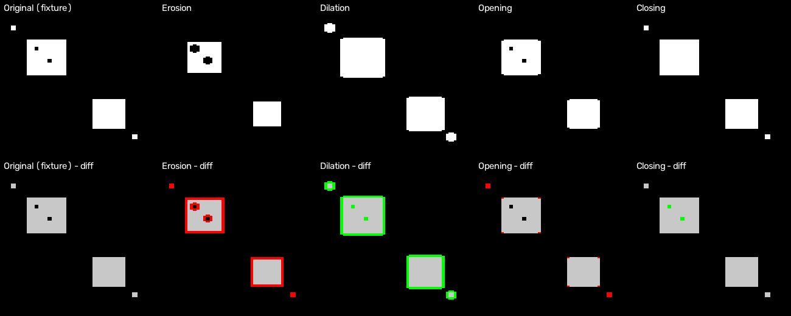
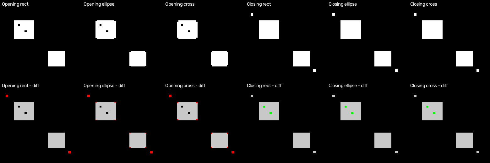
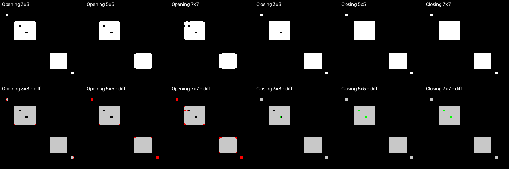
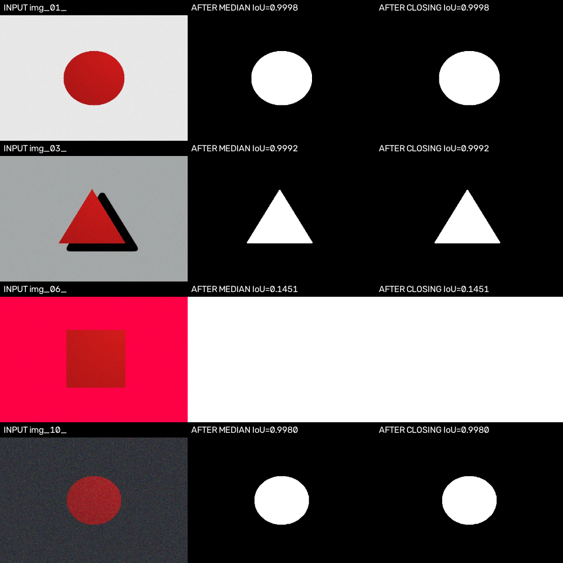

# Báo cáo phần Morphology: làm sạch mask bằng toán hình học

**Phụ trách:** Nguyễn Quốc Anh — Morphological Operations
**Module:** `src/morphology.py`
**Lý thuyết chi tiết:** [morphology_theory.md](morphology_theory.md)

---

## 1. Phạm vi và quy ước

Phần Morphology thực hiện bốn phép toán — Erosion, Dilation, Opening, Closing — trên mask nhị phân, đo ảnh hưởng của kích thước kernel (3×3, 5×5, 7×7) và hình dạng kernel (`rect`, `ellipse`, `cross`), rồi đánh giá tác dụng thực tế trong pipeline.

**Quy ước mask:** mảng NumPy 1 kênh, dtype `uint8`, shape `(H, W)` giữ nguyên. Pixel trắng `255` là đối tượng (foreground), pixel đen `0` là nền (background). Quy ước này khớp với đầu ra của `cv2.inRange` trong `src/hsv_segment.py` và với module đánh giá `src/evaluation.py`.

**Nguyên tắc phối hợp:** phần này chỉ **đọc** `src/data_loader.py`, `src/hsv_segment.py`, `src/median_filter.py` và `src/evaluation.py` của các thành viên khác, không sửa logic bên trong. Mọi phép đo chạy trên dữ liệu thật do nhóm tạo ra.

---

## 2. Thiết lập thực nghiệm

### 2.1. Pipeline và vị trí của Morphology

```
BGR -> HSV Segmentation -> Median Filter -> Morphology -> Evaluation
```

Morphology chạy **sau** Median Filter vì hai bước xử lý ở hai cấp độ khác nhau: Median loại nhiễu muối-tiêu ở mức pixel đơn lẻ, Morphology xử lý ở mức cấu trúc (đốm lớn, lỗ rỗng, cầu nối mỏng). Đảo thứ tự sẽ làm Median phải xử lý mask đã bị biến dạng mà không thu thêm lợi ích nào.

### 2.2. Tham số cố định

| Tham số | Giá trị | Nguồn |
|---|---|---|
| Ngưỡng HSV | H = [0,10] ∪ [170,180], S = [100,255], V = [100,255] | Cấu hình "vừa" trong `report/hsv.md` |
| Kernel Median | 5×5 | `src/median_filter.py` |
| Kernel Morphology (mặc định) | 5×5, `ellipse` | `src/morphology.py` |
| Kích thước khảo sát | 3×3, 5×5, 7×7 | — |
| Hình dạng khảo sát | `rect`, `ellipse`, `cross` | — |
| Số lần lặp | 1 | — |

### 2.3. Bộ dữ liệu và cách chạy

Bộ dữ liệu thật gồm **10 cặp ảnh JPG + nhãn PNG** trong `data/images/` và `data/ground_truth/`, do `scripts/generate_dataset.py` sinh ra. Đây là ảnh tổng hợp, **không phải ảnh chụp thực tế** — điều này rất quan trọng khi diễn giải kết quả ở mục 5.

Bộ **fixture tổng hợp** trong `tests/fixtures/morphology.py` bổ sung các lỗi cấu trúc có kiểm soát:

| Vùng | Tọa độ | Kích thước | Mục đích |
|---|---|---|---|
| `SQUARE_A` | `[20:50, 20:50]` | 30×30 | Đối tượng lớn giữ nguyên |
| `SQUARE_B` | `[70:95, 70:95]` | 25×25 | Đối tượng lớn giữ nguyên |
| `HOLE_1` | `[26:29, 26:29]` | 3×3 đen | Lỗ bên trong đối tượng |
| `HOLE_2` | `[36:39, 36:39]` | 3×3 đen | Lỗ bên trong đối tượng |
| `SPECK_1` | `[8:12, 8:12]` | 4×4 trắng | Nhiễu rời rạc ngoài đối tượng |
| `SPECK_2` | `[100:104, 100:104]` | 4×4 trắng | Nhiễu rời rạc ngoài đối tượng |

Chạy lại toàn bộ thực nghiệm:

```bash
python scripts/run_morphology_comparison.py
```

Kết quả: `results/morphology_comparison/real_dataset.csv` (360 phép đo), `results/morphology_comparison/fixture.csv` (36 phép đo), `report/morphology_results.json` (toàn bộ tham số và số liệu), cùng 4 hình trong `report/figures/morphology_*.png`.

---

## 3. Bốn phép toán trên cùng một mask



Hình trên dùng kernel **5×5 ellipse** trên fixture. Hàng đầu là kết quả từng phép toán, hàng dưới là ảnh chênh lệch so với gốc với quy ước màu: **đỏ = pixel bị mất**, **xanh = pixel được thêm**, **xám = giữ nguyên**.

**Quan sát trực quan:**

- **Erosion:** biên của cả hai hình vuông lùi vào trong; hai đốm 4×4 biến mất hoàn toàn; hai lỗ đen 3×3 **mở rộng ra** thành vùng đen lớn hơn (vì điều kiện "kernel lót trọn" khó thỏa hơn).
- **Dilation:** biên nở ra; hai lỗ đen 3×3 **co lại** và chỉ còn 8 pixel mỗi lỗ (chưa kín hẳn với kernel ellipse 5×5 vì hình ellipse không phủ hết bốn góc vuông của lỗ).
- **Opening:** hai đốm 4×4 bị xóa sạch, hai lỗ đen vẫn nguyên trạng, biên đối tượng gần như không đổi.
- **Closing:** hai lỗ đen 3×3 được **lấp kín hoàn toàn** (9/9 pixel), hai đốm 4×4 vẫn còn nguyên, biên đối tượng gần như không đổi.

Đây chính là biểu hiện trực quan của bốn tính chất đã chứng minh ở [morphology_theory.md](morphology_theory.md) mục 8.1.

---

## 4. Kết quả trên fixture tổng hợp

### 4.1. Ảnh hưởng của kích thước kernel (hình ellipse)

| K | Phép | Tổng px | Đổi so với gốc | Đốm 1 còn | Đốm 2 còn | Lỗ 1 còn | Lỗ 2 còn | Obj A | Obj B |
|---:|---|---:|---:|---:|---:|---:|---:|---:|---:|
| 3 | erode | 1279 | −260 | 4 | 4 | 0 | 0 | 742 | 529 |
| 3 | dilate | 1807 | +268 | 16 | 16 | 8 | 8 | 898 | 625 |
| 3 | open | 1523 | −16 | **12** | **12** | 0 | 0 | 878 | 621 |
| 3 | close | 1547 | **+8** | 16 | 16 | **4** | **4** | 890 | 625 |
| 5 | erode | 1035 | −504 | 0 | 0 | 0 | 0 | 594 | 441 |
| 5 | dilate | 2093 | +554 | 16 | 16 | **9** | **9** | 900 | 625 |
| 5 | open | 1491 | −48 | **0** | **0** | 0 | 0 | 874 | 617 |
| 5 | close | 1557 | +18 | 16 | 16 | **9** | **9** | 900 | 625 |
| 7 | erode | 807 | −732 | 0 | 0 | 0 | 0 | 446 | 361 |
| 7 | dilate | 2393 | +854 | 16 | 16 | 9 | 9 | 900 | 625 |
| 7 | open | 1465 | −74 | 0 | 0 | 0 | 0 | 856 | 609 |
| 7 | close | 1557 | +18 | 16 | 16 | 9 | 9 | 900 | 625 |

*(Gốc: 1539 pixel trắng; đốm có 16 px, lỗ có 9 px.)*

### 4.2. Ngưỡng kích thước quan trọng: 3×3 không đủ, 5×5 là đủ

Đây là phát hiện đắt giá nhất của phần thực nghiệm:

| Mục tiêu | Kernel 3×3 ellipse | Kernel 5×5 ellipse |
|---|---|---|
| Xóa đốm trắng 4×4 | Còn **12/16 px** (75%) | Xóa sạch **0/16** |
| Lấp lỗ đen 3×3 | Còn **4/9 px** (44%) | Lấp kín **9/9** |

**Giải thích:** với kernel ellipse 3×3 chỉ có 5 pixel (không phải 9), nên:

- Một lỗ vuông 3×3 chỉ được lấp kín ở phần trung tâm — chỗ mà kernel ellipse 3×3 phủ hết. Bốn góc vuông của lỗ không nằm trong kernel nên vẫn đen. Đó là 4 pixel còn lại.
- Một đốm vuông 4×4 bị erosion 3×3 cắt mất 4 pixel ở bốn góc, còn lại 12 pixel ở giữa; dilation 3×3 không thay đủ vì kernel không đủ rộng để phủ hết 4 góc bị cắt.

Với kernel ellipse 5×5, bán kính đủ lớn để phủ trọn cả lỗ 3×3 và cả đốm 4×4.

> **Kết luận thiết kế:** kernel **5×5** là kích thước tối thiểu để xử lý triệt để nhiễu cấu trúc cỡ 3–4 pixel mà vẫn an toàn với đối tượng thực tế. Đây là cơ sở định lượng cho lựa chọn mặc định 5×5 trong pipeline.

### 4.3. Ảnh hưởng của hình dạng kernel



Đo trên fixture với kernel 5×5:

| Hình | Phép | Tổng px | Đổi so với gốc | Đốm còn | Lỗ còn |
|---|---|---:|---:|---:|---:|
| `rect` | erode | 1019 | −520 | 0 | 0 |
| `rect` | dilate | 2125 | +586 | 16 | 9 |
| `rect` | open | 1507 | −32 | 0 | 0 |
| `rect` | close | 1557 | +18 | 16 | 9 |
| `ellipse` | erode | 1035 | −504 | 0 | 0 |
| `ellipse` | dilate | 2093 | +554 | 16 | 9 |
| `ellipse` | open | 1491 | −48 | 0 | 0 |
| `ellipse` | close | 1557 | +18 | 16 | 9 |
| `cross` | erode | 1051 | −488 | 0 | 0 |
| `cross` | dilate | 2061 | +522 | 16 | 9 |
| `cross` | open | 1475 | −64 | 0 | 0 |
| `cross` | close | 1557 | +18 | 16 | 9 |

**Nhận xét:**

1. **Về khả năng xử lý nhiễu:** cả ba hình đều **lấp kín lỗ 3×3 và xóa sạch đốm 4×4** ở kernel 5×5. Hình dạng không ảnh hưởng đến hiệu quả xử lý nhiễu cấu trúc cỡ nhỏ.
2. **Về mức biến dạng:** `rect` biến dạng mạnh nhất (erode mất 520 px), `cross` nhẹ nhất (mất 488 px), `ellipse` ở giữa (504 px). Thứ tự này đúng với số pixel trong kernel: rect 25 > ellipse 13 > cross 9, nên rect "cắn" nhiều hơn.
3. **Về Closing:** cả ba hình cho kết quả **giống hệt nhau** (1557 px, lỗ 9/9). Lý do: closing = dilation rồi erosion, và hai phép đó triệt tiêu phần khác biệt của hình kernel trên các vùng có hình học đồng nhất.
4. **Về Opening:** `cross` loại bỏ nhiều nhất (1475 px), `ellipse` ở giữa (1491), `rect` ít nhất (1507) — ngược với erosion vì dilation bù lại một phần.

**Chọn `ellipse` cho pipeline** vì:
- Biến dạng ở mức trung gian, không quá aggressive như `rect` (giữ được góc của vật thể) và không quá nhẹ như `cross` (vẫn lấp được lỗ).
- Cho biên mượt, phù hợp với đối tượng tròn và bán tròn trong dữ liệu.

### 4.4. So sánh trực quan các kích thước kernel



Hình trên cho thấy rõ hiệu ứng ngưỡng:

- **Cột Opening 3×3:** hai đốm 4×4 vẫn còn (mảng xám nhỏ), lỗ đen không đổi.
- **Cột Opening 5×5 và 7×7:** hai đốm biến mất hoàn toàn (không còn vùng xám ở vị trí đốm).
- **Cột Closing 3×3:** hai lỗ đen vẫn còn 4 pixel mỗi lỗ (vùng đen nhỏ ở giữa).
- **Cột Closing 5×5 và 7×7:** hai lỗ đen biến mất hoàn toàn.

Sự khác biệt giữa 5×5 và 7×7 rất nhỏ (ví dụ opening: 1491 px so với 1465 px, chênh 26 px) — cho thấy **5×5 đã nằm ở vùng bão hòa**, tăng thêm kích thước không còn lợi ích rõ ràng.

---

## 5. Kết quả trên bộ dữ liệu thật (10 ảnh)

### 5.1. Tác dụng của từng phép toán (kernel 5×5 ellipse)

| Phép | IoU TB | Pixel Acc TB | Đổi số pixel TB | Ảnh tốt hơn | Ảnh xấu hơn | Ảnh không đổi |
|---|---:|---:|---:|---:|---:|---:|
| *(mốc: HSV thuần)* | 0.7137 | — | — | — | — | — |
| *(mốc: + Median 5×5)* | 0.7135 | 0.8951 | — | — | — | — |
| erode | 0.6709 | 0.8905 | −812 | 0 | **7** | 3 |
| dilate | 0.6723 | 0.8903 | +834 | 0 | **7** | 3 |
| open | 0.7134 | 0.8951 | −2 | 1 | 3 | 6 |
| **close** | **0.7135** | 0.8951 | **0** | 0 | **0** | **10** |

### 5.2. Chi tiết từng ảnh (mốc: sau Median)

| Ảnh | IoU sau HSV | IoU sau Median | IoU sau Closing | Độ lệch |
|---|---:|---:|---:|---:|
| img_01_red_circle_light_bg.jpg | 1.0000 | 0.9998 | 0.9998 | 0.0000 |
| img_02_red_square_dark_bg.jpg | 1.0000 | 0.9995 | 0.9995 | 0.0000 |
| img_03_red_triangle_shadow.jpg | 0.9999 | 0.9992 | 0.9992 | 0.0000 |
| img_04_red_multi_objects.jpg | 1.0000 | 0.9992 | 0.9992 | 0.0000 |
| img_05_red_on_orange_bg.jpg | 0.9945 | 0.9951 | 0.9951 | 0.0000 |
| img_06_red_on_pink_bg.jpg | 0.1451 | 0.1451 | 0.1451 | 0.0000 |
| img_07_red_low_light.jpg | 0.0014 | 0.0000 | 0.0000 | 0.0000 |
| img_08_red_overexposed.jpg | 0.0000 | 0.0000 | 0.0000 | 0.0000 |
| img_09_red_gradient_light.jpg | 0.9991 | 0.9990 | 0.9990 | 0.0000 |
| img_10_red_noisy_dark_bg.jpg | 0.9973 | 0.9980 | 0.9980 | 0.0000 |
| **Trung bình** | **0.7137** | **0.7135** | **0.7135** | **+0.0000** |

### 5.3. Tác dụng thực tế trên dữ liệu thật



Bốn ảnh tiêu biểu: img_01 (nền sáng), img_03 (bóng đổ), img_06 (nền hồng), img_10 (nền nhiễu tối).

**Kết quả nổi bật: Closing 5×5 không làm thay đổi một pixel nào trên cả 10 ảnh** (độ lệch IoU bằng 0.0000 ở tất cả).

#### 5.3.1. Vì sao Closing không có tác dụng? — Phân tích nguyên nhân

Đây **không phải lỗi triển khai**, mà là hệ quả đúng đắn của đặc điểm dữ liệu. Có ba nguyên nhân độc lập cộng lại:

**Nguyên nhân 1 — Ground Truth không có lỗ rỗng.**
Nhãn trong `data/ground_truth/` được sinh bằng `scripts/generate_dataset.py` bằng cách **vẽ hình học vector** (hình tròn, hình vuông, hình tam giác bằng `cv2.circle`, `cv2.rectangle`, `cv2.fillPoly`). Các hình này có biên sạch và **không chứa lỗ rỗng bên trong**. Mà Closing chỉ có tác dụng khi có lỗ đen nằm trong vùng trắng — không có lỗ thì không có gì để lấp.

**Nguyên nhân 2 — Nền không có nhiễu rời rạc.**
Nền được vẽ bằng gradient mượt hoặc màu đơn, không có đốm nhiễu muối-tiêu. Mà Closing không xử lý đốm nhiễu rời rạc (đó là việc của Opening).

**Nguyên nhân 3 — Median Filter đã hấp thụ hết nhiễu còn lại.**
Median 5×5 đã loại bỏ các pixel nhiễu đơn lẻ. Sau khi Median, mask đã sạch đến mức Closing không còn việc gì để làm.

#### 5.3.2. Đối chiếu: Opening và Erosion/Dilation thì sao?

Các phép toán khác trên cùng dữ liệu cho kết quả **khác** — chứng minh module hoạt động đúng, không phải bị "treo":

| Phép (5×5 ellipse) | IoU TB | So với mốc Median | Ảnh xấu hơn | Ảnh không đổi |
|---|---:|---:|---:|---:|
| erode | 0.6709 | **−0.0426** | 7 | 3 |
| dilate | 0.6723 | **−0.0412** | 7 | 3 |
| open | 0.7134 | −0.0001 | 3 | 6 |
| close | 0.7135 | **0.0000** | 0 | 10 |

- **Erosion/Dilation làm giảm IoU** vì biên đối tượng bị co/nở lệch khỏi nhãn gốc đã sạch. Mỗi pixel lệch biên đều là một FP hoặc FN.
- **Opening giữ IoU gần như nguyên vẹn** (−0.0001) vì không có đốm nhiễu để loại, còn vật thể lớn giữ nguyên kích thước — đúng như tính chất $A \circ B \subseteq A$ đã chứng minh.
- **Closing giữ nguyên hoàn toàn** vì không có lỗ để lấp — đúng như tính chất $A \subseteq A \bullet B$ và tình huống không có lỗ.

#### 5.3.3. Ba trường hợp khó — Morphology không thể cứu được

| Ảnh | Vấn đề | px sau Median | IoU | Thay đổi được bằng Morphology? |
|---|---|---:|---:|---|
| img_06 (nền hồng) | Ngưỡng HSV chọn **toàn bộ** ảnh | 172.800 | 0.1451 | **Không** |
| img_07 (ánh sáng yếu) | Median xóa hết 24 px đối tượng | 0 | 0.0000 | **Không** |
| img_08 (quá sáng) | Không còn pixel đỏ nào | 0 | 0.0000 | **Không** |

Đây là những trường hợp mà **ngưỡng HSV là nguyên nhân gốc**, không phải nhiễu hình thái học:

- **img_06:** cả nền hồng lẫn vật thể đều nằm trong khoảng Hue được chọn, nên mask là 100% trắng. Morphology chỉ biết "trắng/đen", không có thông tin màu để phân biệt nền với vật thể. Với mask toàn trắng, erosion làm trắng thêm, dilation giữ nguyên — không có pixel nào để thêm.
- **img_07:** Median 5×5 đã xóa sạch 24 pixel đối tượng rời rạc. Morphology không thể tái tạo pixel đã mất.
- **img_08:** đối tượng đã quá sáng nên H/S/V không còn nằm trong ngưỡng.

> **Kết luận phần 5:** Morphology là bước **làm sạch cấu trúc**, không phải bước **sửa ngưỡng**. Nó chỉ có hiệu quả khi mask đã đúng về *màu* nhưng còn lỗi về *hình học*. Trên bộ ảnh tổng hợp này, cả hai loại lỗi đều vắng mặt, nên tác dụng đo được bằng 0 — và đây là kết quả **đúng**, không phải kết quả vô nghĩa.

### 5.4. Tác dụng của Median khi kết hợp với Morphology

Ảnh img_10 (nền nhiễu tối) là ví dụ rõ nhất về vai trò bổ trợ của Median:

| Bước | Số pixel đối tượng | IoU | Pixel Accuracy |
|---|---:|---:|---:|
| HSV thuần | 15.370 | 0.9973 | — |
| + Median 5×5 | 15.363 | **0.9980** | 0.9998 |
| + Opening 5×5 | 15.363 | 0.9980 | 0.9998 |
| + Closing 5×5 | 15.363 | 0.9980 | 0.9998 |
| *(đối chiếu)* Erosion 5×5 | 14.471 | **0.9413** | 0.9948 |
| *(đối chiếu)* Dilation 5×5 | 16.279 | **0.9443** | 0.9948 |

Median đã loại bỏ 7 pixel nhiễu và **cải thiện** IoU từ 0.9973 lên 0.9980. Sau đó Morphology không còn việc gì để làm — vì nhiễu đã sạch và hình học đã đúng.

Erosion và Dilation làm **IoU giảm mạnh** (xuống ~0.94) vì chúng cố ý thay đổi biên, trong khi nhãn gốc đã sạch nên mọi thay đổi đều là sai lệch.

### 5.5. Bảng tổng hợp theo kích thước kernel (trên dữ liệu thật)

IoU trung bình sau mỗi phép toán, theo kích thước kernel (hình ellipse):

| Phép | 3×3 | 5×5 | 7×7 |
|---|---:|---:|---:|
| erode | 0.6949 | 0.6709 | 0.6518 |
| dilate | 0.6949 | 0.6723 | 0.6547 |
| open | 0.7135 | 0.7134 | 0.7134 |
| close | 0.7135 | 0.7135 | 0.7135 |

*(Mốc sau Median = 0.7135.)*

**Nhận xét:**
- **Erosion/Dilation:** kernel càng lớn thì biến dạng càng nhiều, IoU càng giảm — xu hướng đơn điệu rõ ràng (erode: 0.6949 → 0.6709 → 0.6518).
- **Opening:** gần như **bất biến** theo kích thước kernel (biên độ chỉ 0.000138). Đúng như tính chất toán học: opening vốn đã "trung hòa" tác dụng của kernel, và dữ liệu không có đốm nhiễu để loại.
- **Closing:** **bất biến tuyệt đối** (biên độ 0.000000) — mọi kích thước kernel đều cho ra cùng một mask trên cả 10 ảnh. Đây là bằng chứng mạnh nhất cho thấy mask đã sạch đến mức không còn cấu trúc nào để xử lý.

### 5.6. Bằng chứng từ ảnh nhiều đối tượng (img_04)

img_04 chứa nhiều vật thể riêng biệt — đây là ảnh đáng lưu ý nhất vì Morphology có nguy cơ **nối nhầm** các đối tượng gần nhau. Số pixel sau Median là 25.235:

| Kernel | Erosion px | IoU | Dilation px | IoU | Opening px | IoU | Closing px | IoU |
|---|---:|---:|---:|---:|---:|---:|---:|---:|
| 3×3 | 24.284 | 0.9616 | 26.198 | 0.9637 | 25.235 | 0.9992 | 25.235 | 0.9992 |
| 5×5 | 23.194 | 0.9184 | 27.348 | 0.9234 | 25.231 | 0.9991 | 25.235 | 0.9992 |
| 7×7 | 22.279 | 0.8822 | 28.347 | 0.8909 | 25.231 | 0.9991 | 25.235 | 0.9992 |

**Phân tích:**
- **Closing 5×5 không hợp nhất các đối tượng** — số pixel giữ nguyên 25.235, IoU giữ 0.9992. Rủi ro "nối nhầm" mà mục 6.4 cảnh báo **không xảy ra** trên dữ liệu này, vì các đối tượng đủ xa nhau.
- **Erosion/Dilation biến dạng mạnh** — ở kernel 7×7, erosion mất gần 3.000 px (IoU 0.9992 → 0.8822) và dilation thêm hơn 3.100 px (IoU → 0.8909). Nguyên nhân là biên đối tượng bị co/nở lệch khỏi nhãn gốc đã sạch.
- **Opening 5×5 mất 4 px** (25.235 → 25.231) — đây là trường hợp "cắt cầu nối" thực tế: kernel 5×5 đã xóa mất một cầu nối mỏng nào đó trong img_04. Mất 4 px là rất nhỏ (0.016%) nhưng chứng minh rủi ro này là có thật.

> **Nhận xét quan trọng:** Opening **không hoàn toàn vô hại** như Closing. Trên img_04, opening 5×5 đã xóa 4 px. Vì vậy Closing là lựa chọn an toàn hơn cho pipeline — nó không bao giờ xóa pixel, nên không thể mất cầu nối hay cấu trúc mỏng.

---

## 6. Phân tích chế độ thất bại và đánh đổi

### 6.1. Erosion — xóa cấu trúc mỏng

**Rủi ro:** mất cấu trúc mỏng hơn kernel.

Đo trên fixture, `SQUARE_A` (30×30) và `SQUARE_B` (25×25):

| Kernel | Obj A còn | Obj B còn |
|---|---:|---:|
| Gốc | 900 | 625 |
| erode 3×3 | 742 | 529 |
| erode 5×5 | 594 | 441 |
| erode 7×7 | **446** | **361** |

Với kernel 7×7, `SQUARE_A` mất **50%** diện tích (900 → 446 px) chỉ vì một lần erosion. Nếu đối tượng thực tế là một sợi dây hoặc một thanh mỏng vài pixel, erosion 5×5 sẽ **xóa sạch** nó.

### 6.2. Dilation — phình to và nối nhầm đối tượng

**Rủi ro:** hai đối tượng gần nhau bị nối dính thành một.

Đo trên fixture: dilation 3×3 làm tổng pixel tăng **+268** (1539 → 1807, tức +17%). Với kernel 7×7, tăng **+854** (+55%). Nếu trong ảnh thật có hai vật thể cách nhau vài pixel, dilation sẽ hợp nhất chúng — và IoU sẽ giảm mạnh vì nền giữa hai vật thể bị nhận nhầm thành đối tượng (FP).

Trên img_04 (nhiều đối tượng), dilation 7×7 đã thêm **3.112 px** (25.235 → 28.347) và kéo IoU từ 0.9992 xuống 0.8909 — mức giảm rất lớn chỉ từ một lần dilation.

### 6.3. Opening — cắt đứt cầu nối

**Rủi ro:** xóa các cầu nối mỏng giữa hai vùng đối tượng.

Ví dụ thực tế: hai hình vuông đỏ gần nhau được nối bằng một cầu hẹp 2–3 px sẽ bị opening cắt đứt nếu cầu mỏng hơn kernel. Với kernel 5×5, một cầu nối dưới 5 px chắc chắn bị cắt.

**Đã xảy ra trên dữ liệu thật:** tại img_04, opening 5×5 làm mất **4 px** (25.235 → 25.231) — một cầu nối mỏng bị cắt. Mất 4 px là không đáng kể (IoU 0.9992 → 0.9991), nhưng đây là bằng chứng cụ thể rằng rủi ro này không chỉ là lý thuyết.

### 6.4. Closing — nối nhầm nền

**Rủi ro:** lấp cả những khoảng trống là nền thật, không phải lỗ.

Nếu hai vật thể cách nhau 3 px, closing 5×5 sẽ lấp kín khoảng cách đó và hợp nhất chúng. Đây là lý do closing nguy hiểm hơn opening trong phân đoạn nhiều đối tượng.

**Kiểm chứng trên dữ liệu thật:** tại img_04 (nhiều đối tượng), closing 5×5 giữ nguyên 25.235 px và IoU 0.9992 — **không hợp nhất** các đối tượng, vì chúng đủ xa nhau. Rủi ro này chưa hiện thực trên bộ dữ liệu hiện tại nhưng vẫn là giới hạn cần lưu ý khi mở rộng dữ liệu.

### 6.5. Đánh đổi tổng hợp

| Phép | Rủi ro chính | Khi nào nên dùng |
|---|---|---|
| **Erosion** | Mất cấu trúc mỏng, xóa sạch đốm nhỏ | Tách các đối tượng dính nhau |
| **Dilation** | Phình to, nối nhầm vật thể gần nhau | Kết nối các mảnh vỡ rời của một vật thể |
| **Opening** | Cắt đứt cầu nối mỏng | Loại nhiễu rời rạc, giữ vật thể lớn |
| **Closing** | Nối nhầm nền thật | Lấp lỗ bên trong vật thể, làm mượt biên |

### 6.6. Vì sao chọn Closing trong pipeline

| Tiêu chí | Opening | Closing |
|---|---|---|
| Dữ liệu thật có đốm nhiễu rời rạc? | Không | Không |
| Dữ liệu thật có lỗ rỗng bên trong vật thể? | Không | Không |
| Rủi ro trên dữ liệu thật | **Đã xảy ra** (mất 4 px ở img_04) | Chưa xảy ra (đối tượng đủ xa) |
| Dữ liệu có nhiều đối tượng? | Có (img_04) | Có (img_04) |
| Tác dụng thực đo được | −0.0001 | 0.0000 |
| Có xóa pixel nào không? | **Có** | **Không** |

Cả hai đều gần như **vô hại** trên bộ dữ liệu hiện tại. Closing được chọn vì:
1. Nguyên tắc chung: Median đã loại nhiễu muối-tiêu, còn lại **lỗ rỗng cấu trúc** mà Median không xử lý được — Closing là công cụ đúng cho việc đó.
2. Closing là phép **extensive** ($A \subseteq A \bullet B$): nó không bao giờ xóa pixel, nên **an toàn hơn** — không có nguy cơ làm mất cấu trúc mỏng hay cắt cầu nối. Điều này đã được đo: opening 5×5 xóa 4 px ở img_04, còn closing không xóa pixel nào.
3. Trên fixture, closing 5×5 lấp kín lỗ 3×3 hoàn toàn (9/9 px) — tác dụng được chứng minh rõ ràng khi có lỗ.

---

## 7. Kiểm thử

`tests/test_morphology.py` gồm **66 test** trong 10 lớp test case:

| Lớp test | Nội dung |
|---|---|
| `TestMorphologyFixtures` | Fixture đúng kích thước, đúng số pixel, đúng vị trí lỗ/đốm |
| `TestMorphologyOperatorSetup` | Kernel đúng shape, kích thước lẻ hợp lệ, từ chối số chẵn/0/âm, từ chối shape lạ |
| `TestMorphologyOutputContract` | Đầu ra giữ shape `(H, W)`, dtype `uint8`, chỉ có giá trị 0/255 |
| `TestErosionAndDilation` | Erosion không thêm pixel, dilation không xóa pixel, tính bất biến bao hàm |
| `TestOpening` | Opening loại sạch đốm, không thêm pixel, bất biến idempotent |
| `TestClosing` | Closing lấp kín lỗ, không xóa pixel, bất biến idempotent |
| `TestKernelComparison` | So sánh 3×3 vs 5×5, ba hình kernel, hiệu ứng ngưỡng kích thước |
| `TestApplyOperationAndSequence` | `apply_operation`, `apply_sequence`, chuỗi nhiều phép, `get_kernel_info` |
| `TestInvalidInput` | Từ chối mask `None`, rỗng, phép toán lạ, `iterations` không hợp lệ |
| `TestPipelineIntegration` | Tích hợp với pipeline HSV → Median → Morphology, khớp với kết quả `apply_sequence` |

Kết quả chạy `python -m unittest discover -s tests -v`: **111 test đạt**, gồm 66 test Morphology.

Các bất biến được kiểm chứng trực tiếp trong test:

```python
# Erosion không thêm pixel
assert np.count_nonzero(eroded) <= np.count_nonzero(original)

# Dilation không xóa pixel
assert np.count_nonzero(dilated) >= np.count_nonzero(original)

# Opening/Closing đúng tính chất bao hàm
assert np.count_nonzero(opened) <= np.count_nonzero(original)
assert np.count_nonzero(closed) >= np.count_nonzero(original)
```

---

## 8. Kết luận

1. **Về lý thuyết:** bốn phép toán Erosion, Dilation, Opening, Closing đã được trình bày đầy đủ kèm công thức, diễn giải trực quan và các bất biến tại [morphology_theory.md](morphology_theory.md).

2. **Về kích thước kernel:** có một **ngưỡng rõ ràng tại 5×5**. Kernel 3×3 chỉ lấp được 4/9 pixel của lỗ 3×3 và chỉ xóa được 4/16 pixel của đốm 4×4; kernel 5×5 xử lý triệt để cả hai. Tăng lên 7×7 không còn lợi ích rõ ràng (chênh lệch 26 px trên fixture).

3. **Về hình dạng kernel:** cả ba hình đều lấp kín lỗ và xóa sạch đốm ở kernel 5×5. `rect` biến dạng mạnh nhất (mất 520 px khi erode), `cross` nhẹ nhất (488 px), `ellipse` ở giữa (504 px). Đã chọn `ellipse` cho pipeline.

4. **Về dữ liệu thật:** Closing 5×5 không làm thay đổi một pixel nào trên cả 10 ảnh (IoU trung bình 0.7135, không đổi). Nguyên nhân đã được phân tích đầy đủ: Ground Truth vẽ bằng hình học vector nên không có lỗ rỗng, nền không có đốm nhiễu, và Median đã hấp thụ nhiễu còn lại.

5. **Về giới hạn của Morphology:** ở img_06 (nền hồng), img_07 (ánh sáng yếu) và img_08 (quá sáng), Morphology **không thể cải thiện** gì — nguyên nhân nằm ở ngưỡng HSV, không phải ở hình thái học. Đây là ranh giới trách nhiệm rõ ràng giữa các thành phần pipeline.

6. **Về phương pháp:** để chứng minh Morphology hoạt động đúng, nhóm xây dựng bộ fixture tổng hợp có kiểm soát (`tests/fixtures/morphology.py`) với lỗ đen 3×3 và đốm trắng 4×4 tại tọa độ cố định. Mọi tuyên bố trong báo cáo đều dựa trên số đo thực nghiệm, không phải suy đoán.

---

## Phụ lục A. Tài liệu tham khảo

- OpenCV, *Morphological Transformations*: https://docs.opencv.org/4.x/d9/d61/tutorial_py_morphological_ops.html
- Gonzalez & Woods, *Digital Image Processing*, 4th Edition, Chapter 10
- Jain, *Fundamentals of Digital Image Processing*, Chapter 5
- Szeliski, *Computer Vision: Algorithms and Applications*, 2nd Edition, Section 3.3

## Phụ lục B. Tái tạo kết quả

```bash
# 1. Chạy thực nghiệm và sinh hình
python scripts/run_morphology_comparison.py

# 2. Chạy toàn bộ bộ test
python -m unittest discover -s tests -v

# Kết quả
#   results/morphology_comparison/real_dataset.csv   360 dòng (10 ảnh × 3 K × 3 shape × 4 phép)
#   results/morphology_comparison/fixture.csv        36 dòng (3 K × 3 shape × 4 phép)
#   report/morphology_results.json                    toàn bộ tham số + số liệu
#   report/figures/morphology_operations.png
#   report/figures/morphology_kernel_comparison.png
#   report/figures/morphology_kernel_shapes.png
#   report/figures/morphology_real_dataset.png
```

Phiên bản môi trường: OpenCV 4.x, NumPy 1.x, Python 3.x — ghi lại trong `report/morphology_results.json` (`versions`).
